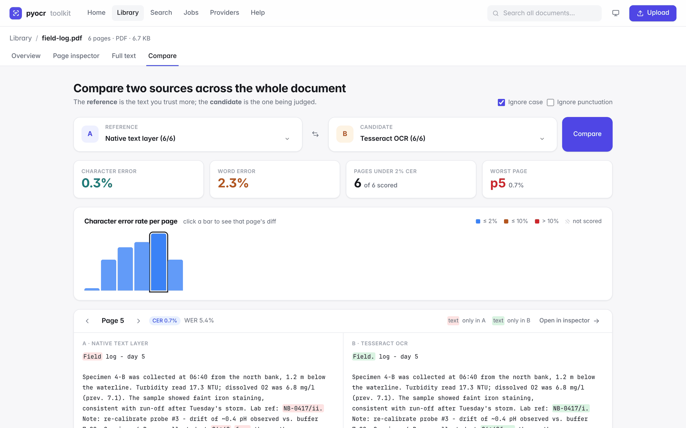
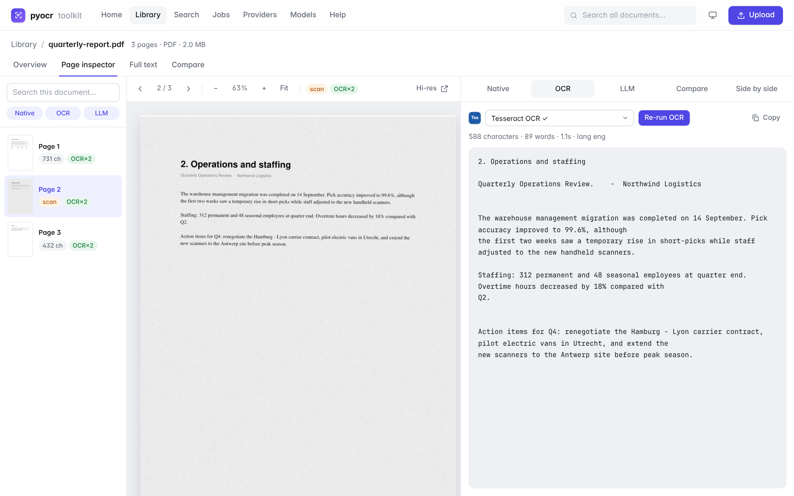
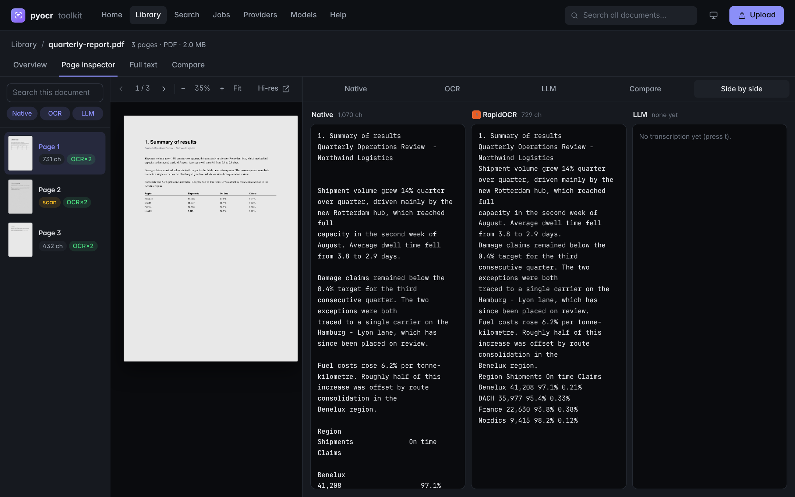
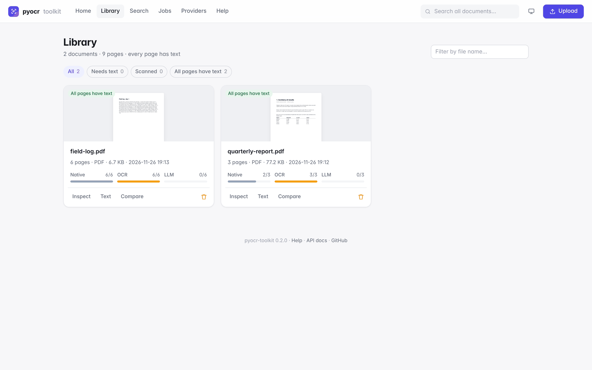
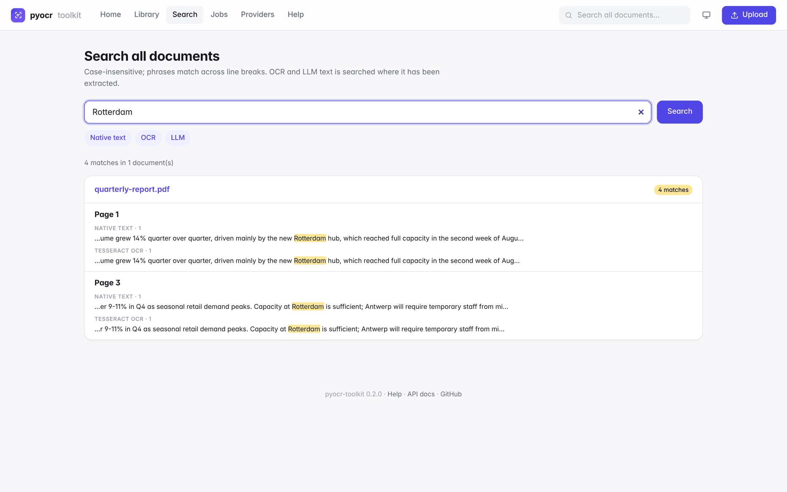
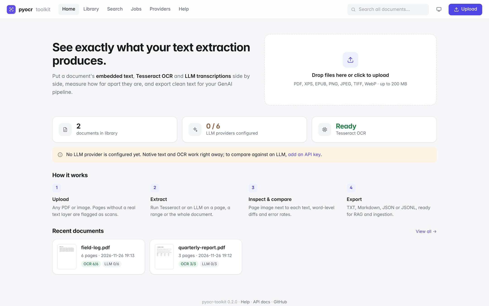
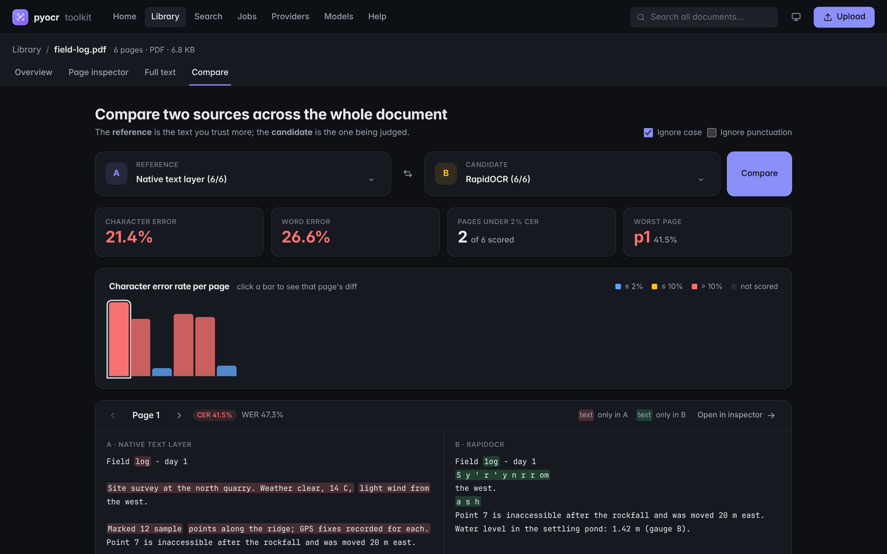

<div align="center">


# pyocr-toolkit

**See exactly what text you get out of a PDF or image, and compare how different extraction methods read it.**

[](https://github.com/utkarsh5026/pyocr/actions/workflows/ci.yml)

[](LICENSE)


[**Website**](https://utkarsh5026.github.io/pyocr/) ·
[Install](#install) ·
[Screenshots](#screenshots) ·
[Providers](#configure-llm-providers) ·
[CLI](#command-line) ·
[How it works](#how-it-works)

<br>



</div>

---

Many GenAI workflows start with "get the text out of this PDF". **pyocr-toolkit** is a local web app (plus CLI) for
checking that step. Upload a document and you get three versions of every page:

| | Source | What it is | Good at | Weak at |
|---|---|---|---|---|
| 📄 | **Native text** | Text already embedded in the file (PyMuPDF) | Born-digital PDFs. Exact and instant. | Scans have none. Broken font maps produce gibberish. |
| 🔍 | **OCR** | Tesseract, or any of 8 other OCR engines (below), on the rendered page image | Free/local or cheap cloud, gives word positions | Varies by engine: Tesseract struggles with tables, columns, poor scans, handwriting |
| ✨ | **LLM transcription** | A vision LLM told to copy the page *verbatim* | Hard pages, layout, context | Costs money. May quietly "fix" or skip text. |

Then you can:

- **Extract** page by page, a range like `1-5,9`, or the whole document, as background jobs
- **Compare** any two sources: character and word error rate (CER/WER), word-level diffs, a per-page chart
- **Search** across every document and every source at once
- **Export** clean text as TXT, Markdown, JSON or JSONL for your pipeline

**LLM providers:** Claude (Anthropic API), OpenAI, Azure OpenAI, Claude on Azure (Microsoft Foundry), Google
Gemini, and any OpenAI-compatible server (Ollama, vLLM, LM Studio, OpenRouter) for local or private models.

**OCR engines:** Tesseract (default), plus RapidOCR, EasyOCR, PaddleOCR and docTR running locally, and Google
Cloud Vision, Azure AI Document Intelligence, AWS Textract and Mistral OCR in the cloud. Each engine is its own
source, so you can score engines against each other or against an LLM.

**Inputs:** PDF, XPS, EPUB, CBZ, MOBI, FB2, SVG, PNG, JPEG, TIFF (multi-page), BMP, GIF, WebP and anything else
[PyMuPDF](https://pymupdf.readthedocs.io/) opens.

## Screenshots

<table>
  <tr>
    <td width="50%"><b>Page inspector</b>: a scanned page (no embedded text, flagged <code>scan</code>) next to its Tesseract OCR text.<br><br></td>
    <td width="50%"><b>Side by side</b>, in dark mode: native, OCR and LLM text in synced columns.<br><br></td>
  </tr>
  <tr>
    <td><b>Library</b>: how much of each document has native, OCR and LLM text.<br><br></td>
    <td><b>Search</b>: every document, every source, with the source of each hit.<br><br></td>
  </tr>
  <tr>
    <td><b>Home</b>: upload, plus setup status for Tesseract and LLM providers.<br><br></td>
    <td><b>Compare</b>, in dark mode.<br><br></td>
  </tr>
</table>

---

## Install

You need **Python 3.10+**. **Tesseract** is optional but recommended (it enables the OCR source).

```bash
# Tesseract (optional)
sudo apt-get install tesseract-ocr tesseract-ocr-eng   # Debian / Ubuntu
brew install tesseract                                  # macOS
choco install tesseract                                 # Windows (or the UB Mannheim installer)
```

**Option A: pipx** (recommended, installs it as an isolated command):

```bash
pipx install git+https://github.com/utkarsh5026/pyocr
```

**Option B: pip** in a virtual environment:

```bash
python -m venv .venv && source .venv/bin/activate      # Windows: .venv\Scripts\activate
pip install git+https://github.com/utkarsh5026/pyocr
```

> [!NOTE]
> The PyPI name is `pyocr-toolkit` (plain `pyocr` is a different, unrelated library). Once it's published to
> PyPI, `pipx install pyocr-toolkit` will also work.

**Option C: Docker** (Tesseract and several language packs included):

```bash
git clone https://github.com/utkarsh5026/pyocr && cd pyocr
cp .env.example .env            # add your keys
docker compose up -d            # → http://localhost:8000
```

## Run

```bash
pyocr init          # writes a .env template in the current folder: add the API keys you have
pyocr doctor        # checks Tesseract, providers and the data folder
pyocr serve --open  # starts the app on http://127.0.0.1:8000 and opens your browser
```

Everything you upload and extract is stored in `./data` (change it with `DATA_DIR`). The in-app **Help** page
(`/help`) covers every feature in detail.

## The web app

| Page | What you do there |
|---|---|
| **Home** `/` | Drop files to upload; see setup status and recent documents. |
| **Library** `/documents` | Document cards showing native / OCR / LLM coverage and how many pages still have no text. Filter by status or name; delete. |
| **Overview** `/documents/{id}` | Start background extraction (any OCR engine or LLM) for all pages or a range such as `1-5,9`; follow progress; see every *source* (engine + model + prompt) with token usage; export; page thumbnails. |
| **Page inspector** `/documents/{id}/pages/{n}` | Page image next to native, OCR and LLM text; run OCR or an LLM on just this page; per-page diff; a *Side by side* tab with all three texts in synced columns; search hits drawn on the image. Keyboard: `←/→`, `/`, `1-5`, `t`, `o`. |
| **Full text** `/documents/{id}/text` | Read the whole document from one source, optionally beside the page images; find, copy, download. |
| **Compare** `/documents/{id}/compare` | Score source B against source A on every page: document-level CER/WER, a clickable CER-per-page chart, and an aligned side-by-side diff of the selected page (opens on the worst page). Works for OCR vs LLM, native vs LLM, or **model vs model**. |
| **Search** `/search` | Search all documents at once. |
| **Jobs** `/jobs` | All background extractions, with progress, errors and tokens. |
| **Providers** `/providers` | Which settings are set or missing, a form to set keys/endpoints in the browser, plus a **Test connection** button per provider. |
| **Models** `/models` | Search a catalog of vision models rated for transcription (excellent / good / fair / not suitable, with price and reason); list the models your key can use and pick one. |
| **Help** `/help` | The full guide: concepts, metrics, workflows, troubleshooting. |
| **API docs** `/docs` | Interactive OpenAPI docs for the JSON API. |

## Configure LLM providers

Paste keys on the **Providers** page (saved to `DATA_DIR/credentials.json`, owner-only, applied immediately and
taking precedence over the environment), or set them in `.env` (created by `pyocr init`) or as environment
variables and restart. Keys stay on the server and are never sent to the browser.

| Provider | Required | Optional |
|---|---|---|
| Claude (Anthropic API) | `ANTHROPIC_API_KEY` | `ANTHROPIC_MODEL` (default `claude-opus-5-5`), `ANTHROPIC_EFFORT` |
| OpenAI | `OPENAI_API_KEY` | `OPENAI_MODEL` (default `gpt-6.2-sol`), `OPENAI_BASE_URL` |
| Azure OpenAI | `AZURE_OPENAI_API_KEY`, `AZURE_OPENAI_ENDPOINT` | `AZURE_OPENAI_DEPLOYMENT`, `AZURE_OPENAI_API_VERSION` |
| Claude on Azure (Foundry) | `ANTHROPIC_FOUNDRY_API_KEY`, `ANTHROPIC_FOUNDRY_RESOURCE` | `ANTHROPIC_FOUNDRY_MODEL` |
| Google Gemini | `GEMINI_API_KEY` | `GEMINI_MODEL` (default `gemini-3.8-flash`) |
| Ollama / vLLM / LM Studio / OpenRouter | `OPENAI_COMPATIBLE_BASE_URL` | `OPENAI_COMPATIBLE_MODEL`, `OPENAI_COMPATIBLE_API_KEY` |

Any model or deployment name can be typed in the UI; the defaults are just starting points. The **Models** page
and the hint under each model box say whether a model suits transcription (custom names are marked as such). The model must accept
images. For a fully local setup, run Ollama with a vision model and set
`OPENAI_COMPATIBLE_BASE_URL=http://localhost:11434/v1`.

## Configure OCR engines

Tesseract is the default engine. Every other engine is optional, and the Providers page (and `pyocr engines`) shows
which are ready, with a **Test** button for each. Cloud keys and engine settings can be set there too, or as
environment variables. Local engines run on your machine; the first run downloads the
model weights. Cloud engines send the rendered page image to that service, and nowhere else.

| Engine | Kind | Install / required settings | Optional |
|---|---|---|---|
| Tesseract | local | system package (`apt install tesseract-ocr`, `brew install tesseract`) | `TESSERACT_LANGUAGE` |
| RapidOCR | local | `pip install "pyocr-toolkit[rapidocr]"` (ONNX Runtime, no PyTorch) | – |
| EasyOCR | local | `pip install "pyocr-toolkit[easyocr]"` (PyTorch) | `EASYOCR_LANGUAGES`, `OCR_GPU` |
| PaddleOCR | local | `pip install "pyocr-toolkit[paddleocr]"` (PaddlePaddle) | `PADDLEOCR_LANGUAGE` |
| docTR | local | `pip install "pyocr-toolkit[doctr]"` (PyTorch) | `OCR_GPU` |
| Google Cloud Vision | cloud | `GOOGLE_VISION_API_KEY` | `GOOGLE_VISION_LANGUAGE_HINTS` |
| Azure AI Document Intelligence | cloud | `AZURE_DOCUMENT_INTELLIGENCE_ENDPOINT`, `AZURE_DOCUMENT_INTELLIGENCE_KEY` | – |
| AWS Textract | cloud | `pip install "pyocr-toolkit[textract]"`, `AWS_REGION` | `AWS_ACCESS_KEY_ID`, `AWS_SECRET_ACCESS_KEY` (or `~/.aws`) |
| Mistral OCR | cloud | `MISTRAL_API_KEY` | `MISTRAL_OCR_MODEL` (default `mistral-ocr-latest`) |

Mistral OCR returns Markdown without word positions, so its search hits can't be drawn on the page image. In the
API, OCR sources are `ocr` (Tesseract) and `ocr:<engine>`, e.g. `ocr:easyocr`.

## Command line

```bash
pyocr extract report.pdf --engine llm -p anthropic --pages 1-5 --format jsonl -o report.jsonl
pyocr extract scan.tiff --engine ocr --format md            # Tesseract, Markdown to stdout
pyocr extract scan.pdf --engine ocr:easyocr                  # any OCR engine (see `pyocr engines`)
pyocr extract born-digital.pdf --engine native              # embedded text only, no network
pyocr compare scan.pdf -p openai -m gpt-6.2-sol                   # per-page OCR / native CER vs an LLM
pyocr providers                                             # which providers are ready
pyocr engines                                               # which OCR engines are ready
python -m pyocr_toolkit --help                              # same CLI without the script on PATH
```

Documents processed on the command line also appear in the web app's library.

## How it works

1. **Native text.** A PDF page is a list of drawing instructions ("glyph 37 at (72, 700)"). Born-digital files map
   each glyph back to a character, so the text can be rebuilt exactly. A scan is only a picture, so it has no text.
2. **OCR.** The page is rendered to pixels (300 DPI) and an OCR engine (Tesseract by default) recognises characters
   from their shapes, reporting a box for each word (or line, split into words). That is why search can highlight OCR hits on the page.
3. **LLM.** The page image goes to a vision model with a strict "transcribe, don't correct" prompt
   ([`prompts.py`](src/pyocr_toolkit/llm/prompts.py)). It reads in context, so it is strong on hard pages, but it can
   "fix" typos, which the diff view exposes.
4. **Comparison.** *Edit distance* is the minimum number of character insertions, deletions and substitutions
   between two texts. **CER** = edits / reference characters; **WER** is the same count over words. For example,
   "the cat sat" → "the bat sat" has 1 edit, so CER = 1/11 = 9%. Whitespace is normalised first, because line
   breaks aren't reading errors. Disagreement between two engines is not proof of error: compare against a
   born-digital PDF's native text when you need ground truth.

The Help page explains each of these in more depth.

## Privacy and security

- Uploads, OCR output and LLM output are stored as plain files under `DATA_DIR`.
- A page image is sent to an LLM provider only when you start a transcription, and only to the provider you
  picked. Native text and Tesseract run entirely locally.

> [!WARNING]
> **There is no login.** `pyocr serve` listens on `127.0.0.1` by default. If you use `--host 0.0.0.0` or Docker,
> put it behind your own authentication.

## Development

```bash
git clone https://github.com/utkarsh5026/pyocr && cd pyocr
pip install -e ".[dev]"
pytest              # LLM providers are tested against mocked HTTP: no keys, no network
ruff check src tests
pyocr serve
```

Or use the task runner: `make` lists every developer command grouped by category (`make install`, `make check`,
`make dev` for auto-reload, `make docker-up`, ...). Without `make` (e.g. on Windows), run `python makefile.py <task>`.

See [CONTRIBUTING.md](CONTRIBUTING.md) for the code layout and how to add a provider.

The project website lives in [`docs/`](docs/) (plain HTML and CSS, no build step) and is deployed to GitHub Pages by
[`.github/workflows/pages.yml`](.github/workflows/pages.yml) on every push to `main` that touches it.

## License

Apache-2.0. See [LICENSE](LICENSE).
